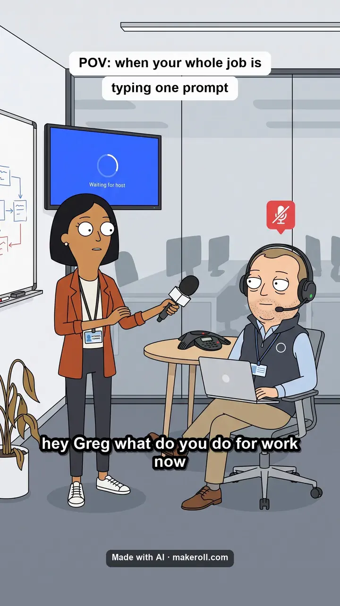
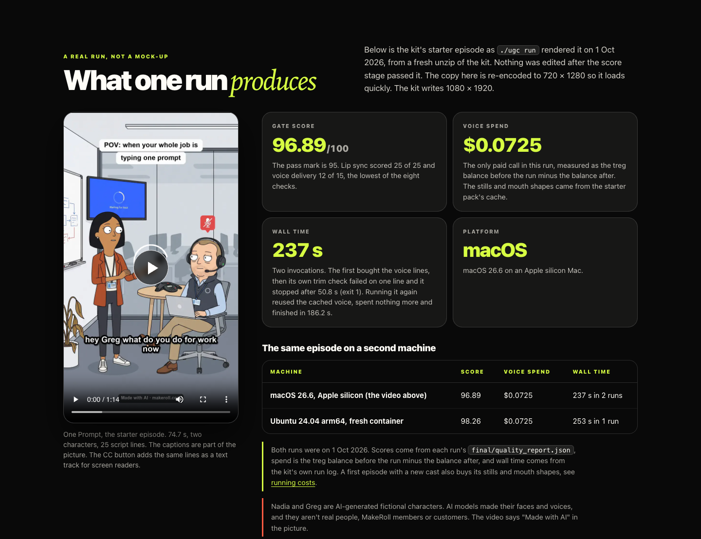
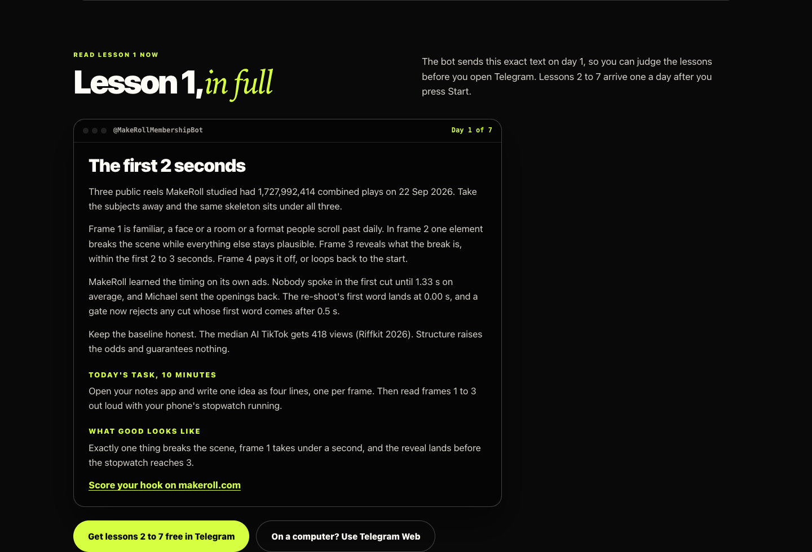
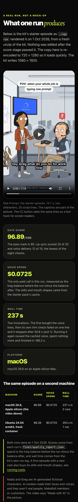

# MakeRoll UGC pipeline

The MakeRoll UGC pipeline is a kit that runs on your own computer and turns a short 2D animated show into a finished vertical video. You give it script beats, two characters, their voices and a visual style. One command, `./ugc run`, takes that through eight stages and ends with a captioned 1080 x 1920 video at 25 fps. The kit won't call a video done until its own scorer rates it 95/100 or higher.

This repository is a public showcase. It holds no kit code. The kit itself comes with [MakeRoll Lifetime](https://makeroll.com/#pricing), and the setup guide is public at [makeroll.com/ugc-pipeline](https://makeroll.com/ugc-pipeline/).

## What one run produces

<a href="media/one-prompt-starter-episode-1080x1920.mp4"></a>

[`media/one-prompt-starter-episode-1080x1920.mp4`](media/one-prompt-starter-episode-1080x1920.mp4) is the kit's starter episode, One Prompt, byte for byte as `./ugc run` wrote it on 1 Oct 2026 from a fresh unzip of the kit (17.2 MB, 74.7 s, SHA-256 `7be40456f95e92278ecf9312aa449b23d7a209fec47e385e58abcd6a61486fd4`). Nothing was edited after the score stage passed it. The captions are part of the picture, and [`media/one-prompt-captions.vtt`](media/one-prompt-captions.vtt) has the same 42 lines as a text track.

Nadia and Greg are AI-generated fictional characters. AI models made their faces and voices, and they aren't real people, MakeRoll members or customers. The video says "Made with AI" in the picture.

## Measured runs

| Machine | Gate score | Voice spend | Wall time | Exit |
|---|---|---|---|---|
| macOS 26.6, Apple silicon (the video above) | 96.89 / 100 | $0.072540 | 237 s over 2 invocations | 1, then 0 |
| Ubuntu 24.04 arm64, fresh container | 98.26 / 100 | $0.072540 | 253 s in 1 invocation | 0 |

Where the numbers come from:

- The score is the `total` in each run's `final/quality_report.json`. The pass mark is 95. On the Mac run, lip sync scored 25 of 25 and voice delivery 12 of 15, the lowest of the eight checks.
- Spend is the treg.to balance before the run minus the balance after. On the Mac that was $15.406856 before and $15.334316 after. The voice lines were the only paid call, because the starter pack ships the character stills and mouth shapes already made.
- Wall time comes from the kit's own run log. The first Mac invocation bought the voice lines, then its own trim check failed on one line and it stopped after 50.8 s with exit 1. Running it again reused the cached voice, spent nothing more and finished in 186.2 s with exit 0.

A passing score means the craft checks passed: sync, timing, captions and sound. It says nothing about views, followers or sales, and no run promises any of those.

## The eight stages

| # | Stage | Paid? | What it does |
|---|---|---|---|
| 1 | teardown | free | Loads the reference measurements the final score grades against |
| 2 | script | free | Measures the screenplay against seven countable comedy defects before anything is paid for |
| 3 | cast | paid | Draws the characters and the set, every still anchored to one master shot |
| 4 | voice | paid | Speaks every beat and saves the time each word starts and ends |
| 5 | mouths | paid | Draws seven mouth shapes per character and turns the word timings into a mouth track |
| 6 | animate | free | Holds each still and moves only the mouth and eyelids, like limited 2D animation |
| 7 | assemble | free | Cuts to the real audio, burns in the captions and masters the file |
| 8 | score | free | Rates the master on eight weighted checks and exits 0 only at 95 or higher |

Every stage is cached on a hash of its inputs, so changing one line of the script buys that one voice line again, not the whole cast. Paid calls go through your own treg.to account. `./ugc run --dry-run` prints the plan and the estimate and spends nothing. Running costs for a new cast are on the [guide's costs section](https://makeroll.com/ugc-pipeline/#costs).

## Hand the setup to your AI agent

After a Lifetime payment the MakeRoll bot sends a personal member key and one line for an agent that can run terminal commands, such as Claude Code or Codex. The line has this shape, with your own key in place of the placeholder:

```
Set up the MakeRoll UGC pipeline: https://makeroll.com/ugc-pipeline/agent.md  key: YOUR_MEMBER_KEY
```

[`agent.md`](agent.md) in this repo is a copy of the public instruction file the agent reads. It installs and checks the kit, runs a free dry run, shows you the estimate and waits for your yes before any paid run. Signing in to treg.to stays your job. Keep the key private and never commit it anywhere.

## Start free, or get the kit

- [MakeRoll Basics](https://makeroll.com/basics/) is free: 7 short lessons in Telegram, one a day, each with a 10-minute task. No card. [Start it in the bot](https://t.me/MakeRollMembershipBot?start=basics), or [read lesson 1 on the page](https://makeroll.com/basics/#lesson-1) first.
- [MakeRoll Lifetime](https://t.me/MakeRollMembershipBot?start=lifetime) is $199 once and includes the UGC pipeline kit. The [setup guide](https://makeroll.com/ugc-pipeline/) shows every step before you decide.

## Screenshots

The sample run section of the guide, desktop and phone, and lesson 1 on the Basics page.







## Licence

The written docs in this repository (this README and `agent.md`) are licensed under [CC BY 4.0](LICENSE). The video, poster, captions and screenshots are not covered by that licence. They stay MakeRoll's, all rights reserved, and you may link to them. The kit has its own licence, shown at [makeroll.com/ugc-pipeline/licence](https://makeroll.com/ugc-pipeline/licence/).

Maintained by [theluckystrike](https://github.com/theluckystrike). Questions: support@makeroll.com.
